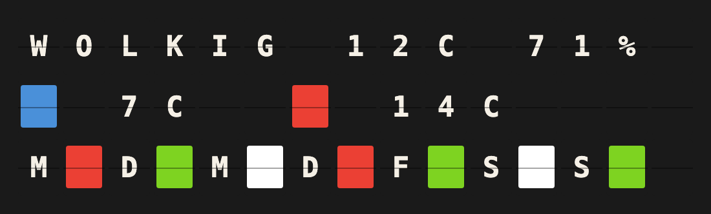
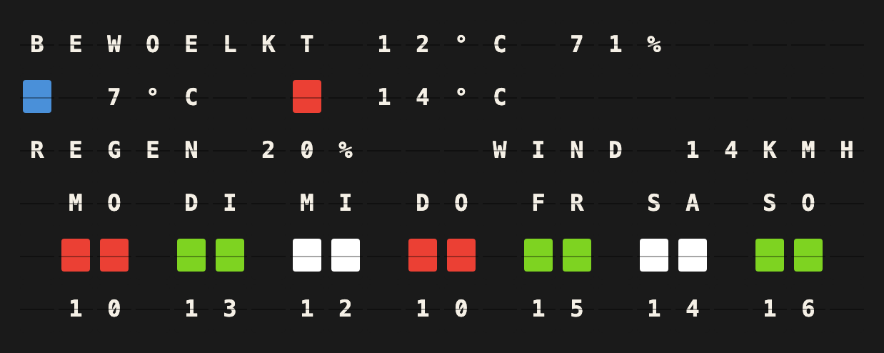

# Open Meteo Weather Setup Guide

Show the weather for any place on your Vestaboard: now, today, and the week as colored tiles.

## Overview

**What it does:**

- The current condition, temperature and humidity
- Today's low and high, and on a Flagship the chance of rain and the wind
- This week as one colored tile per day: green for a good day, white for a grey one, red for rain, snow or thunder

**Prerequisites:** None — works out of the box. Forecasts come from [Open-Meteo](https://open-meteo.com), which needs no account and no API key. All you need are the coordinates of the place you want to show.

## Quick Setup

### 1. Enable the Plugin

Open **Integrations** in FiestaBoard, find **Open Meteo Weather** and install it. Then open its card and switch **Enabled** on.

### 2. Configure Open Meteo Weather

Enter the **Coordinates** as `latitude, longitude`, for example `52.52, 13.405` for Berlin:

- **Google Maps:** right-click the spot and click the numbers at the top of the menu to copy them.
- **OpenStreetMap:** the coordinates are in the URL and under *Show address*.

Pick the **Language** (German or English). Everything else has a sensible default; see the reference below. If you own a Note, also look at **Degree sign** — some Notes carry a heart where the degree sign would be.

### 3. Create a Board Template

Create a page and put this on its **first** line, with the line set to left alignment and no wrap:

```
{{open_meteo_weather.block}}
```

That one variable fills the board with the built-in layout. FiestaBoard splits it across the board rows, and the rows are exactly as wide as the board, so nothing gets cut or shifted.

### 4. View on Your Board

The board shows the weather like this on a Note:



And like this on a Flagship:



## Template Variables

| Variable | Description | Example |
|----------|-------------|---------|
| `{{open_meteo_weather.block}}` | The whole built-in layout, rows separated by newlines | see above |
| `{{open_meteo_weather.line1}}` … `{{open_meteo_weather.line6}}` | The same rows one by one; empty past the board's height | |
| `{{open_meteo_weather.condition}}` | Current condition | `BEWOELKT` |
| `{{open_meteo_weather.condition_short}}` | The same in six tiles or fewer | `WOLKIG` |
| `{{open_meteo_weather.temp}}` / `{{open_meteo_weather.temp_unit}}` | Current temperature and unit | `12` / `°C` |
| `{{open_meteo_weather.feels_like}}` | Apparent temperature | `10` |
| `{{open_meteo_weather.humidity}}` | Relative humidity in % | `71` |
| `{{open_meteo_weather.wind}}` / `{{open_meteo_weather.wind_unit}}` | Wind speed and unit | `14` / `KMH` |
| `{{open_meteo_weather.low}}` / `{{open_meteo_weather.high}}` | Today's low and high | `7` / `14` |
| `{{open_meteo_weather.rain_chance}}` / `{{open_meteo_weather.rain}}` | Today's chance of precipitation and total | `20` / `0.0` |
| `{{open_meteo_weather.color}}` | Today's color tile | `{69}` |
| `{{open_meteo_weather.week}}` | Weekday initial plus tile for each day | `M{63}D{66}…` |
| `{{open_meteo_weather.week_tiles}}` | Just the seven tiles | `{63}{66}…` |
| `{{open_meteo_weather.days.N.*}}` | One day, N = 0…6: `name`, `condition`, `high`, `low`, `rain`, `rain_chance`, `rating`, `color`, `date` | `MO`, `REGEN`, … |
| `{{open_meteo_weather.location}}` | Location name from the settings | `BERLIN` |

## Configuration Reference

| Setting | Default | Description |
|---------|---------|-------------|
| Coordinates | — | `latitude, longitude`. Comma, semicolon or space between them. |
| Location name | — | Only used by `{{open_meteo_weather.location}}`. |
| Language | Deutsch | Condition words and weekday names, German or English. |
| Units | Metric | Imperial asks Open-Meteo for °F, mph and inches. |
| Week overview | Calendar week | Monday–Sunday, or the next seven days starting today or tomorrow. |
| Rain threshold (mm) | 1.0 | A wet day with less precipitation than this counts as mixed, not bad. |
| Colors | green / contrast / red | One per rating: a color, **Contrast** (white on a black board, black on a white one) or **Background** (the board's own color). |
| Degree sign | Always | Always `12°C`, Auto drops it on note-shaped boards (`12C`), Blank space `12 C`, Never `12C`. |
| Umlauts | Expand | `BEWOELKT` or `BEWOLKT`. |
| Refresh interval | 900 s | Minimum 300 s. Open-Meteo updates current conditions every 15 minutes. |

### Environment Variables

None.

### Rate limits

Open-Meteo is free for non-commercial use up to 10,000 requests a day. The plugin asks once per refresh interval, and boards that ask for the same place at the same moment share one answer, so a board refreshing every 15 minutes uses fewer than 100 requests a day.

## Troubleshooting

**The board shows a heart instead of the degree sign.** Your Note carries a heart on tile 62. Set **Degree sign** to *Auto* or *Blank space*.

**"Coordinates" is rejected.** Enter two numbers, latitude first: `52.52, 13.405`. A place name like `Berlin` does not work.

**Today's tile is red although it barely rained.** Open-Meteo rates a day by its most severe weather. Raise the **Rain threshold** so light drizzle counts as mixed.

**The weekdays look wrong.** "Today" is the location's own date, worked out by Open-Meteo from the coordinates — not the date where FiestaBoard runs.

**Grey days are invisible on a white board.** The mixed color defaults to *Contrast*, which is black on a white board. If you picked *Background*, the tile takes the board's own color and reads as a gap.
